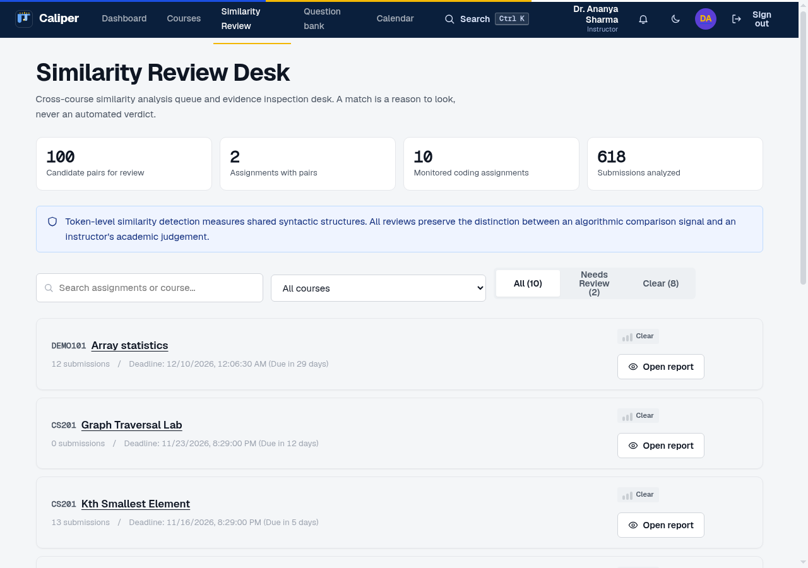
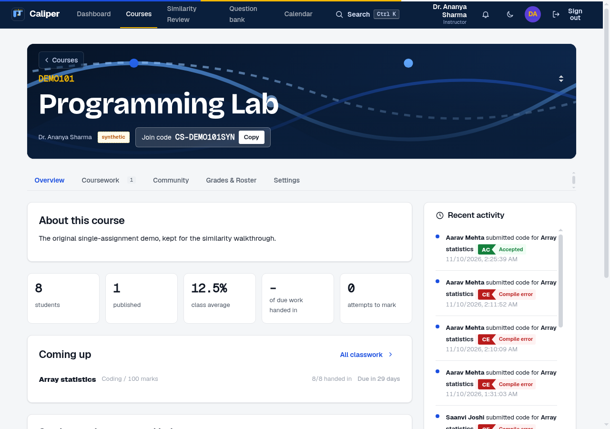
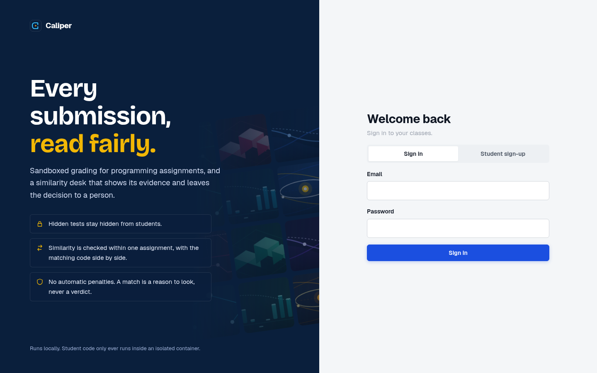
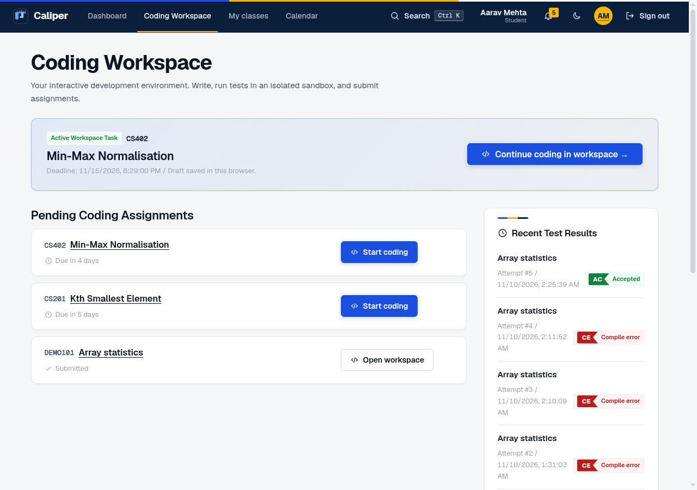
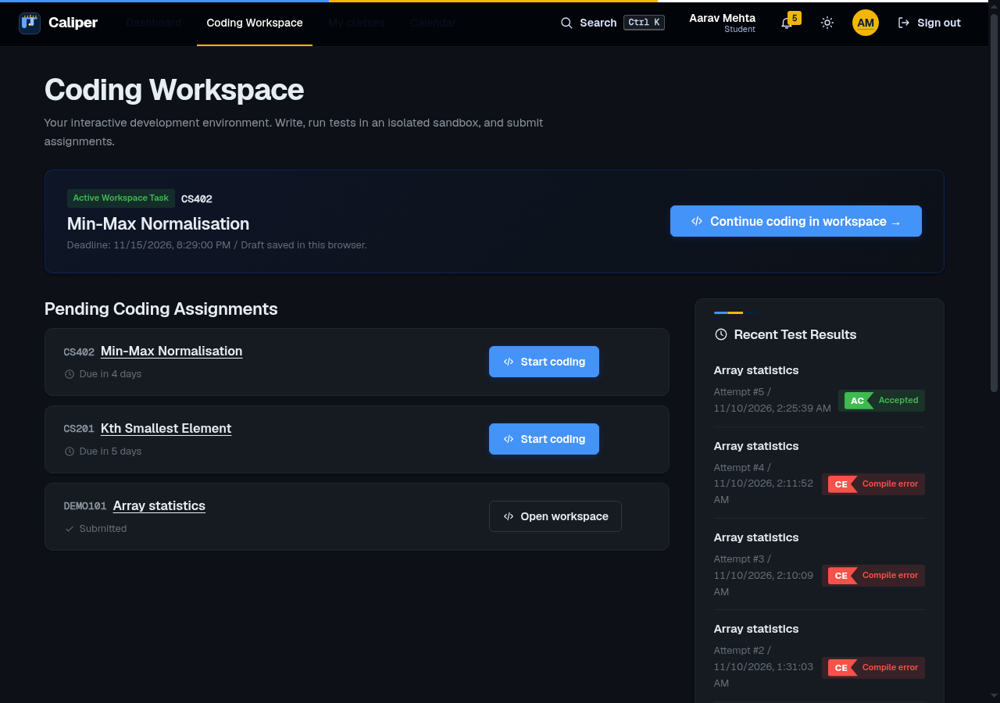
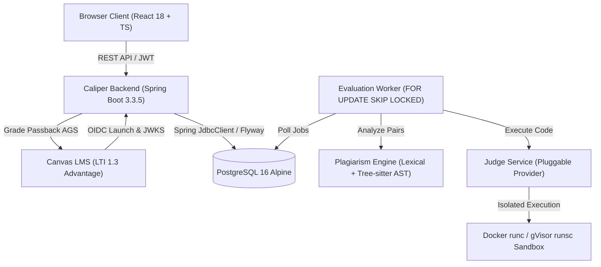
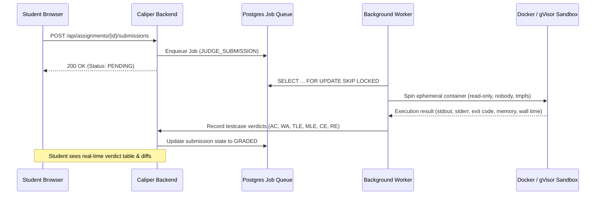
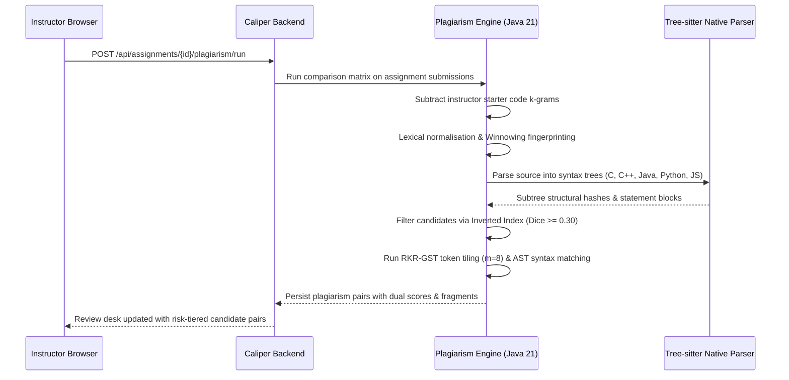

# Caliper

> **The Precision Instrument for Code Evaluation & Academic Integrity**

[](https://openjdk.org/projects/jdk/21/)
[](https://spring.io/projects/spring-boot)
[](https://react.dev/)
[](https://www.typescriptlang.org/)
[](https://www.postgresql.org/)
[](https://gvisor.dev/)
[](https://www.1edtech.org/standards/lti)
[](https://tree-sitter.github.io/)
[](https://github.com/HARSH4885-svg/Caliper/actions)
[](https://github.com/HARSH4885-svg/Caliper)

Caliper is a self-hosted, cross-platform academic evaluation engine and learning management platform designed for computer science education. It unifies an in-browser coding workspace with secure, pluggable containerised multi-language code execution (Docker `runc` and Google gVisor `runsc`), a dual-engine plagiarism investigation desk (lexical Winnowing + RKR-GST and Tree-sitter AST structural analysis), 1EdTech LTI 1.3 Advantage integration for Canvas LMS, and automated formal PDF audit report generation for academic integrity boards.

Caliper is built entirely on open, auditable software: **zero paid external AI APIs, zero opaque SaaS dependencies, and zero invasive student surveillance**.

---

## Table of Contents

- [The Core Philosophy](#the-core-philosophy)
- [Two Core Product Experiences](#two-core-product-experiences)
  - [1. Instructor Similarity Review Desk](#1-instructor-similarity-review-desk)
  - [2. Student Coding Workspace](#2-student-coding-workspace)
- [Visual Showcase](#visual-showcase)
- [Core Advanced Capabilities](#core-advanced-capabilities)
  - [1. Pluggable Multi-Runtime Sandbox Architecture](#1-pluggable-multi-runtime-sandbox-architecture)
  - [2. Dual-Engine Similarity Pipeline (Lexical + AST Structural)](#2-dual-engine-similarity-pipeline-lexical--ast-structural)
  - [3. LTI 1.3 Advantage & Canvas LMS Integration](#3-lti-13-advantage--canvas-lms-integration)
  - [4. Formal Academic Integrity Dossier Export (PDF)](#4-formal-academic-integrity-dossier-export-pdf)
  - [5. Complete Windows 11 / 10 Native Compatibility](#5-complete-windows-11--10-native-compatibility)
- [System Architecture & Design Patterns](#system-architecture--design-patterns)
  - [High-Level Topology](#high-level-topology)
  - [Execution & Evaluation Pipeline](#execution--evaluation-pipeline)
  - [Dual-Engine Similarity Pipeline](#dual-engine-similarity-pipeline)
  - [Object-Oriented Design Patterns](#object-oriented-design-patterns)
- [Technology Stack](#technology-stack)
- [Installation & Local Setup](#installation--local-setup)
  - [Prerequisites](#prerequisites)
  - [Windows 11 / 10 Native Setup (PowerShell)](#windows-11--10-native-setup-powershell)
  - [Linux / macOS Native Setup (Bash)](#linux--macos-native-setup-bash)
- [Environment Variables](#environment-variables)
- [Usage Guide](#usage-guide)
  - [Pre-Seeded Demonstration Accounts](#pre-seeded-demonstration-accounts)
  - [Instructor Workflow Walkthrough](#instructor-workflow-walkthrough)
  - [Student Workflow Walkthrough](#student-workflow-walkthrough)
- [Testing & Quality Verification](#testing--quality-verification)
  - [Automated Test Suite Breakdown](#automated-test-suite-breakdown)
  - [Running Tests](#running-tests)
- [Continuous Integration (CI/CD)](#continuous-integration-cicd)
- [Security & Sandbox Isolation Model](#security--sandbox-isolation-model)
- [Academic Integrity & Ethical Policy](#academic-integrity--ethical-policy)
- [Implemented System Capabilities & Verification Status](#implemented-system-capabilities--verification-status)
- [Contributing](#contributing)
- [License & Scientific Acknowledgements](#license--scientific-acknowledgements)
- [Contact & Repository](#contact--repository)

---

## The Core Philosophy

Computer science assignment management frequently suffers from two compounding problems:

1. **Fragmented Toolchains**: Instructors must juggle generic LMS platforms (Canvas, Moodle) that lack native code execution, external commercial autograders with per-submission credit charges, and detached web IDEs where student progress is easily lost.
2. **The "Black Box" Plagiarism Trap**: Commercial similarity tools present instructors with arbitrary percentage scores with no insight into how those numbers were derived. Common starter code, standard data structures, and cosmetic identifier renamings either trigger false positives or escape detection entirely.

**Caliper resolves both challenges:**

- **Deterministic & Explainable**: Similarity analysis is grounded in peer-reviewed algorithmic computer science. It pairs lexical tokenisation and identifier normalisation (Winnowing + Running Karp-Rabin Greedy String Tiling) with deep Abstract Syntax Tree (AST) structural parsing via Tree-sitter. Every match is visually mapped line-by-line with exact token and syntax node coordinates.
- **An Investigation Signal, Not an Accusation**: Caliper explicitly treats similarity as a triaged signal for human instructor review. The platform provides formal audit classifications (`CLEARED_AUTHORIZED_COLLABORATION`, `FALSE_POSITIVE`, `INVESTIGATING`, `CONFIRMED_VIOLATION`), ensuring academic judgement remains with qualified educators.
- **Pluggable Multi-Runtime Sandboxing**: Student code executes in isolated environments with strictly dropped capabilities, non-root users (`nobody:65534`), restricted memory/CPU/PIDs, disabled networking, and host-level watchdog timers. Supports both standard Docker `runc` and Google gVisor `runsc` user-space kernel virtualization.
- **Native Canvas LMS & LTI 1.3 Ready**: Built-in 1EdTech LTI 1.3 Core with OIDC login initiation, RSA/JWKS verification, automatic student/instructor role mapping, and Assignment and Grade Services (AGS) automated grade passback.
- **Official PDF Hearing Dossiers**: One-click generation of formal academic integrity dossiers designed for faculty disciplinary committees and review boards, complete with case metadata, dual scores, and aligned code excerpts.
- **Cross-Platform Engineering**: First-class support for both Windows 11/10 (PowerShell + Docker Desktop WSL2) and Linux (native Docker/gVisor).

---

## Two Core Product Experiences

Caliper organises its entire user experience around the two primary activities that define computer science education:

```
                                  CALIPER PLATFORM
                ┌───────────────────────┴───────────────────────┐
                ▼                                               ▼
       INSTRUCTOR WORKFLOW                              STUDENT WORKFLOW
┌───────────────────────────────┐               ┌───────────────────────────────┐
│     Similarity Review Desk    │               │        Coding Workspace       │
│  - Multi-course triage queue  │               │  - CodeMirror browser IDE     │
│  - Starter code subtraction   │               │  - Custom input scratchpad    │
│  - Winnowing & RKR-GST tiling │               │  - Public test case suite     │
│  - Tree-sitter AST structural │               │  - Real-time compiler diffs   │
│  - Side-by-side syntax viewer │               │  - Local draft persistence    │
│  - Formal PDF dossier export  │               │  - LTI assignment launch      │
│  - Formal triage dispositions │               │  - Automated grade passback   │
└───────────────────────────────┘               └───────────────────────────────┘
```

### 1. Instructor Similarity Review Desk

Accessible globally via the navigation bar (`/reviews`) and per-assignment (`/assignments/:id/plagiarism`), the Similarity Review Desk provides an evidence-based investigation pipeline:

- **Cross-Course Triage Queue**: Aggregates flagged submission pairs across all active courses, categorized into risk tiers: `HIGH_PRIORITY_REVIEW`, `NEEDS_REVIEW`, and `LOW_SIMILARITY`.
- **Starter Code Subtraction**: Automatically subtracts instructor template code $k$-grams before fingerprinting, eliminating false positives caused by boilerplate or problem harnesses.
- **Dual-Engine Metrics**: Displays both the Lexical Distinctive Evidence Score (Winnowing + RKR-GST) and the AST Structural Syntax Score (Tree-sitter).
- **Synchronized Side-by-Side Code Viewer (`/pairs/:id`)**: Renders Student A and Student B code with proportional synchronized scrolling. Clicking any matched fragment highlights the identical logic block in both files.
- **Progressive Disclosure Toggle**: Allows instructors to seamlessly toggle between **Lexical Tokens** view (token-level matches) and **AST Structural Nodes** view (syntax subtree matches).
- **Formal Academic Determinations**: Record institutional audit determinations (`UNREVIEWED`, `INVESTIGATING`, `CONFIRMED_VIOLATION`, `FALSE_POSITIVE`, `CLEARED_AUTHORIZED_COLLABORATION`, `DISMISSED`) accompanied by immutable faculty review notes.
- **One-Click Dossier Export**: Generates printable PDF hearing dossiers and standalone HTML reports directly from the desk.

### 2. Student Coding Workspace

Accessible via the main navigation (`/workspace`) and directly from assignment listings (`/assignments/:id/code`), the Student Coding Workspace delivers a distraction-free development environment:

- **Multi-Language Browser IDE**: Built on CodeMirror 6 with syntax highlighting, line numbering, bracket matching, and auto-indentation supporting C, C++, Java 21, Python 3.12, and Node.js.
- **Instant Scratchpad Execution**: Run custom test inputs through the Docker sandbox with execution times under 50ms (`Ctrl+Enter` shortcut), providing intermediate stdout, stderr, execution wall-clock time, and memory metrics.
- **Public Test Case Runner**: Validate code against official instructor test cases before submitting, viewing expected vs actual output diffs.
- **Local Draft Resilience**: Automatically persists in-progress code to browser `localStorage`, ensuring student work is never lost across accidental tab closures or network interruptions.
- **Automated Submission & Evaluation**: One-click submission enqueues code in PostgreSQL's distributed task queue, executes hidden test cases in ephemeral containers, updates student gradebooks, and synchronizes scores via LTI 1.3 AGS.

---

## Visual Showcase

### Instructor Experience

| Global Similarity Review Desk | Course Dashboard & Clustered Navigation |
|:---:|:---:|
|  |  |
| *Unified cross-course triage queue with risk tiering, filter tabs, and AST metrics.* | *Structured course workspace with 5 clustered operational tabs.* |

| Instructor Command Center | Precision Dark Mode Interface |
|:---:|:---:|
|  |  |
| *Immediate access to urgent similarity alerts and active course rosters.* | *High-contrast, eye-strain-free theme tailored for late-night grading sessions.* |

### Student Experience

| Dedicated Workspace Hub | High-Contrast Workspace (Dark) |
|:---:|:---:|
|  |  |
| *One-click access to open programming assignments and active local drafts.* | *Distraction-free environment for focused algorithmic problem solving.* |

---

## Core Advanced Capabilities

### 1. Pluggable Multi-Runtime Sandbox Architecture

Caliper abstracts sandbox execution behind the `SandboxExecutionProvider` interface, allowing instructors and administrators to select the security isolation tier appropriate for their host:

```
                ┌──────────────────────────────────────────────┐
                │          SandboxExecutionProvider            │
                │        (Judge Execution Abstraction)         │
                └──────────────────────┬───────────────────────┘
                                       │
                         ┌─────────────┴─────────────┐
                         ▼                           ▼
               ┌──────────────────┐        ┌──────────────────┐
               │  Docker Provider │        │ gVisor Provider  │
               │      (runc)      │        │     (runsc)      │
               │  Standard Linux  │        │ User-space guest │
               │    namespaces    │        │  kernel barrier  │
               │ (Default engine) │        │(Zero kernel leak)│
               └──────────────────┘        └──────────────────┘
```

- **`DockerSandboxProvider` (`runc`) [Default]**: High-speed container execution. Drops all Linux capabilities (`--cap-drop ALL`), runs as non-root `nobody:65534`, mounts read-only root filesystems, mounts ephemeral tmpfs scratch volumes, restricts memory (256MB) and PIDs (64), and disables networking (`--network none`).
- **`GVisorSandboxProvider` (`runsc`)**: Invokes Google's gVisor sandbox runtime via `--runtime=runsc`. Untrusted code interacts with a dedicated Sentry user-space kernel in Go, preventing host kernel exploits or shared kernel escapes.
- **MicroVM Extensibility**: Caliper's `SandboxExecutionProvider` interface defines a clean contract for integrating hardware-assisted KVM microVM runners (e.g. Firecracker or Cloud-Hypervisor) without altering judge business logic.
- **Host Capability Detection & Diagnostic API**: Caliper automatically detects available runtimes on the host. Inspect runtime readiness via `GET /api/admin/sandbox/status`.

### 2. Dual-Engine Similarity Pipeline (Lexical + AST Structural)

```
                               SOURCE SUBMISSIONS
                                       │
                     ┌─────────────────┴─────────────────┐
                     ▼                                   ▼
          LEXICAL TOKEN PIPELINE              AST STRUCTURAL PIPELINE
     ┌───────────────────────────────┐   ┌───────────────────────────────┐
     │ Tokenisation & Identifier Map │   │ Tree-sitter Grammar Parsing   │
     │ Starter Code Subtraction      │   │ Identifier & Literal Erasure  │
     │ Winnowing Fingerprinting      │   │ Subtree Structural Hashing    │
     │ Inverted Index Candidate Pair │   │ Statement Sequence Alignment  │
     │ RKR-GST Token Tile Alignment  │   │ AST Fragment Coordinate Map   │
     └───────────────┬───────────────┘   └───────────────┬───────────────┘
                     │                                   │
                     └─────────────────┬─────────────────┘
                                       ▼
                       DUAL-EVIDENCE SIMILARITY REPORT
                    - Distinctive Lexical Score (0.00-1.00)
                    - AST Structural Syntax Score (0.00-1.00)
                    - Progressive Disclosure (Tokens vs Nodes)
```

- **Lexical Analysis (Winnowing + RKR-GST)**:
  - Eliminates common starter code and assignment templates.
  - Normalizes identifiers sequentially based on first appearance (`v0`, `v1`...).
  - Computes Winnowing fingerprint hashes ($k=10, w=5$) and selects candidate pairs via inverted index.
  - Performs Running Karp-Rabin Greedy String Tiling ($m=8$) to identify contiguous shared blocks with rarity weighting.
- **AST Structural Analysis (Tree-sitter)**:
  - Uses native Java bindings for Tree-sitter across **C, C++, Java, Python, and JavaScript**.
  - Erases all variable names, function names, literals, and comments to analyze syntax structures.
  - Generates structural hashes for every syntax subtree ($\text{size} \ge 3$), calculating syntax block overlap.
  - Detects structural plagiarism even when a student renames variables, alters whitespace, reorders independent declarations, or wraps code in dummy functions.
- **Progressive Disclosure UI**:
  - The Instructor Review Desk (`/pairs/:id`) allows switching between **Lexical Tokens** view and **AST Structural Nodes** view with highlighted code spans.

### 3. LTI 1.3 Advantage & Canvas LMS Integration

Caliper integrates directly into university Learning Management Systems using the 1EdTech LTI 1.3 Advantage Core standard:

- **OIDC 3-Legged Initiation**: Secure initiation endpoint (`GET` / `POST /api/lti/login_initiation`) handles launch requests from Canvas.
- **Cryptographic Verification & Public JWKS**: Caliper generates an internal RSA-2048 keypair and exposes standard public JWKS at `GET /api/lti/jwks`.
- **Replay Protection**: Single-use nonces and state tokens stored with atomic verification and 15-minute expiration prevent launch replay attacks.
- **Role & Roster Mapping**: Automatically maps Canvas roles (`Learner` $\to$ `STUDENT`, `Instructor` / `Administrator` $\to$ `INSTRUCTOR`) and provisions accounts on first launch.
- **Assignment and Grade Services (AGS)**: Caliper's `LtiGradePassbackService` requests OAuth2 client-credentials tokens using private key JWT assertions (`client_assertion`) and automatically publishes scores to the Canvas gradebook lineitem.

### 4. Formal Academic Integrity Dossier Export (PDF)

Caliper provides one-click generation of formal Academic Integrity Hearing Dossiers (`GET /api/plagiarism-pairs/{pairId}/report.pdf`):

- **Institutional Presentation**: Built using OpenPDF with typography, case metadata, and timestamps.
- **Case Identification**: Course code, assignment title, instructor of record, and dual-party metadata (student names, IDs, attempt numbers).
- **Dual Forensic Metrics**: Side-by-side presentation of Lexical Distinctive Score and AST Structural Syntax Score.
- **Aligned Code Evidence**: Tabulated matched fragments with file names, start/end line coordinates, token counts, and AST node types.
- **Review History**: Full audit trail of recorded faculty decisions (`CONFIRMED_CONCERN`, `DISMISSED`, `INCONCLUSIVE`) and reviewer notes.
- **Institutional Disclaimer**: Clear statement that statistical similarity is an investigative aid, preserving student rights to human faculty review.

### 5. Complete Windows 11 / 10 Native Compatibility

Caliper features native Windows support:
- **Zero POSIX Shell Dependencies on Windows**: Complete suite of 8 production PowerShell scripts in `scripts/windows/` with parameter validation, error trapping, and colored logging.
- **Windows-Safe Volume Mounting**: `DockerRunner` automatically detects Windows host environments and normalizes paths (e.g. `C:\Users\...` to `C:/Users/...:/work:rw`), omitting Linux-only SELinux `,Z` flags that break on Docker Desktop for Windows.
- **Automated Windows Prerequisite Helper**: `scripts/windows/install-prerequisites.ps1` checks and installs Java 21, Maven, Node.js, and Docker Desktop via `winget`.

---

## System Architecture & Design Patterns

### High-Level Topology



### Execution & Evaluation Pipeline



### Dual-Engine Similarity Pipeline



### Object-Oriented Design Patterns

Caliper strictly adheres to object-oriented programming principles and design patterns:

1. **Strategy Pattern for Question Grading (`QuestionGradingStrategy`)**:
   - Encapsulates question grading algorithms across question types (`MCQ`, `MULTI_SELECT`, `TRUE_FALSE`, `SHORT_ANSWER`, `FILL_BLANK`, `OUTPUT`, `LONG`, `FILE`, `CODE`).
   - Uses `AbstractQuestionGradingStrategy` for shared normalization and scoring, dispatched polymorphically via `QuestionGraderRegistry`.
2. **Strategy Pattern for Academic Report Export (`DossierExporter`)**:
   - Abstracts dossier generation into interchangeable format strategies (PDF via OpenPDF, HTML, and JSON), dynamically resolved through `DossierExportRegistry`. (Tabular CSV summary export is handled by dedicated controller endpoints rather than through the polymorphic `DossierExporter` registry).
3. **Repository Pattern & Dependency Inversion (`CourseRepository`)**:
   - Decouples HTTP web routing from relational persistence. `CourseController` delegates data operations to `CourseRepository` (implemented by `JdbcCourseRepository`), isolating SQL queries from business logic.
4. **Pluggable Factory Strategy (`SandboxExecutionProvider`)**:
   - Decouples code evaluation from underlying container runtimes. Switches dynamically between `DockerSandboxProvider` (`runc`) and `GVisorSandboxProvider` (`runsc`) without modifying judge execution services.

---

## Technology Stack

| Layer | Technologies | Purpose & Verification |
|:---|:---|:---|
| **Frontend Framework** | React 18.3, TypeScript 5.6, Vite 5.4 | Single Page Application, typed API client, and fast module bundling. |
| **Code Editor** | CodeMirror 6 | Multi-language browser editor with syntax highlighting, custom theme, and gutter marks. |
| **Styling & Design** | Pure CSS Tokens, Geist & Bricolage Grotesque fonts | Editorial design system, high-contrast dark mode, and zero third-party UI library bloat. |
| **Backend Framework** | Java 21 LTS, Spring Boot 3.3.5, Spring Security | Enterprise REST API, security filters, rate limiting, and worker orchestration. |
| **Data Persistence** | PostgreSQL 16 Alpine, Spring `JdbcClient`, Flyway 10 | Relational database, explicit SQL queries (no JPA/Hibernate overhead), migrations `V1`–`V8`. |
| **Distributed Queue** | PostgreSQL `SELECT ... FOR UPDATE SKIP LOCKED` | Lock-free, transactional asynchronous task queue for evaluation and similarity jobs. |
| **Code Sandboxing** | Docker (`runc`), Google gVisor (`runsc`), Linux cgroups v2 | Ephemeral execution containers for C, C++, Java 21, Python 3.12, and Node.js 20. |
| **Similarity Engine** | Pure Java 21, Tree-sitter (Bonede bindings) | Lexical Winnowing ($k=10, w=5$), RKR-GST ($m=8$), and AST syntax subtree matching. |
| **LMS Integration** | 1EdTech LTI 1.3 Advantage Core, JJWT 0.12.6 | OIDC authentication, Canvas course/role mapping, and AGS grade passback. |
| **Report Generation** | OpenPDF 2.2.2 | Formal academic integrity hearing audit dossiers in PDF format. |
| **Testing** | JUnit 5, Mockito, Vitest, React Testing Library | 239 automated unit, acceptance, integration, and scenario tests. |

---

## Installation & Local Setup

### Prerequisites

- **Java Development Kit (JDK)**: Java 21 LTS (OpenJDK / Eclipse Temurin).
- **Apache Maven**: Version 3.9+ (`mvn`).
- **Node.js & npm**: Node.js 20 LTS or 22 LTS with `npm`.
- **Docker**: Docker Engine 24+ or Docker Desktop with WSL2 (Windows).
- **Git**: Modern Git client with LF line ending support.

---

### Windows 11 / 10 Native Setup (PowerShell)

Ensure **Docker Desktop** is running in Linux container mode (WSL 2 backend).

1. **Verify Environment Prerequisites**:
   Open PowerShell and run:
   ```powershell
   .\scripts\windows\check-environment.ps1
   ```
   *(If tools are missing, run `.\scripts\windows\install-prerequisites.ps1` to install them via `winget`)*.

2. **Initialize Environment & Start Database**:
   ```powershell
   .\scripts\windows\dev-up.ps1
   ```
   *Generates a secure `.env` file with random credentials if missing, starts PostgreSQL, and waits for health checks.*

3. **Build Multi-Language Sandbox Runner Images**:
   ```powershell
   .\scripts\windows\build-sandbox-images.ps1
   ```
   *Builds the 4 runner images (`codesentinel/runner-native:1`, `runner-java:1`, `runner-python:1`, `runner-node:1`).*

4. **Start Backend & Frontend**:
   In PowerShell Window 1:
   ```powershell
   .\scripts\windows\start-backend.ps1
   ```
   In PowerShell Window 2:
   ```powershell
   .\scripts\windows\start-frontend.ps1
   ```

5. **Access Caliper**:
   Open your browser to `http://localhost:5173`. Log in with `demo-instructor@demo.invalid` / `demo-password-1`.

---

### Linux / macOS Native Setup (Bash)

1. **Clone and Configure**:
   ```bash
   git clone https://github.com/HARSH4885-svg/Caliper.git
   cd Caliper
   cp .env.example .env # edit credentials if desired
   ```

2. **Build Sandbox Images**:
   ```bash
   ./scripts/build-sandbox-images.sh
   ```

3. **Start PostgreSQL**:
   ```bash
   docker compose up -d postgres
   ```

4. **Build and Run Backend**:
   ```bash
   set -a; source .env; set +a
   mvn spring-boot:run -pl backend
   ```

5. **Start Frontend Dev Server**:
   ```bash
   cd frontend
   npm install
   npm run dev
   ```

6. **Access Caliper**:
   Open your browser to `http://localhost:5173`.

---

## Environment Variables

All settings are configured via environment variables and loaded through `.env` or container environments:

| Variable | Required | Default | Description |
|:---|:---:|:---:|:---|
| `POSTGRES_HOST` | No | `127.0.0.1` | PostgreSQL host. |
| `POSTGRES_PORT` | No | `5432` | PostgreSQL port. |
| `POSTGRES_DB` | No | `codesentinel` | Relational database name. |
| `POSTGRES_USER` | No | `codesentinel` | Relational database user. |
| `POSTGRES_PASSWORD` | **Yes** | — | Database password. |
| `DB_URL` | No | `jdbc:postgresql://127.0.0.1:5432/codesentinel` | Full JDBC connection URL. |
| `JWT_SECRET` | **Yes** | — | Cryptographic HMAC secret key (at least 32 characters). |
| `JWT_TTL_MINUTES` | No | `480` | Session token validity duration in minutes (default: 8 hours). |
| `SERVER_ADDRESS` | No | `127.0.0.1` | Backend binding address (localhost-only for security). |
| `SERVER_PORT` | No | `8080` | Backend HTTP listening port. |
| `CORS_ORIGIN` | No | `http://127.0.0.1:5173` | Allowed browser origin for development. |
| `STORAGE_ROOT` | No | `./storage` | Directory where uploaded files and submissions live. |
| `STORAGE_PROVIDER` | No | `local` | Storage provider (`local` filesystem storage). |
| `CALIPER_SANDBOX_RUNTIME` | No | `docker` | Isolation runtime: `docker` (standard `runc`) or `gvisor` (`runsc`). |
| `DOCKER_BIN` | No | `docker` | Path to Docker CLI binary. |
| `SEED_DEMO` | No | `false` | When `true`, seeds synthetic CS courses, assignments, submissions, and quizzes on first boot. |
| `RATE_LIMIT_PER_MINUTE` | No | `30` | Maximum requests per client IP per minute for sensitive endpoints. |
| `REGISTRATION_ENABLED` | No | `true` | Enables student account registration. |
| `BOOTSTRAP_INSTRUCTOR_EMAIL` | No | — | Optional email to seed an initial instructor account. |
| `BOOTSTRAP_INSTRUCTOR_PASSWORD`| No | — | Password for the bootstrap instructor account. |
| `JUDGE_WORKER_ENABLED` | No | `true` | Enables background evaluation worker in the backend process. |
| `JUDGE_POLL_MILLIS` | No | `1500` | Background worker queue polling frequency in milliseconds. |
| `PLAG_K` | No | `10` | Winnowing $k$-gram size in tokens. |
| `PLAG_W` | No | `5` | Winnowing window size in tokens. |
| `PLAG_CANDIDATE_CUTOFF` | No | `0.30` | Minimum Dice similarity threshold to trigger deep AST and RKR-GST comparison. |
| `PLAG_HIGH_PRIORITY_THRESHOLD` | No | `0.80` | Score threshold for flagging `HIGH_PRIORITY_REVIEW`. |

---

## Usage Guide

### Pre-Seeded Demonstration Accounts

When booted with `SEED_DEMO=true`, Caliper populates a synthetic computer science department:

- **Instructor Account**:
  - **Email**: `demo-instructor@demo.invalid`
  - **Password**: `demo-password-1`
  - **Identity**: Dr. Ananya Sharma (Department of Computer Science)
- **Student Accounts**:
  - **Emails**: `student1@demo.invalid` through `student8@demo.invalid` (up to `student72@demo.invalid`)
  - **Password**: `demo-password-1`

---

### Instructor Workflow Walkthrough

1. Log in as `demo-instructor@demo.invalid`.
2. Access the **Similarity Review Desk** via **Similarity Review** in the top navigation bar.
3. Review active assignment clusters and click **Inspect Pair** on a flagged candidate pair.
4. Compare code in the side-by-side viewer. Toggle between **Lexical Tokens** and **AST Structural Nodes** to inspect syntax subtree alignment.
5. Click **PDF Dossier** to download a formatted Academic Integrity Audit Dossier.
6. Record an official institutional determination (`CONFIRMED_CONCERN`, `DISMISSED`, `INCONCLUSIVE`) with review notes.

---

### Student Workflow Walkthrough

1. Log in as `student1@demo.invalid`.
2. Click **Coding Workspace** in the top navigation bar to view open assignments.
3. Select an active programming assignment (e.g. *Array Statistics*).
4. Code in the CodeMirror editor with syntax assistance.
5. Run custom scratchpad tests via `Ctrl+Enter`.
6. Click **Run Tests** to validate against public test cases.
7. Click **Submit Assignment** to trigger evaluation.

---

## Testing & Quality Verification

### Automated Test Suite Breakdown

Caliper includes **239 automated tests** passing across four distinct test suites:

```
Test Suite Distribution:
├── engine:   75 tests (Lexer, Winnowing, RKR-GST, Tree-sitter AST similarity, benchmarks)
├── judge:    50 tests (Docker runc, gVisor provider, cross-platform paths, timeouts, memory limits)
├── backend:  74 tests (Acceptance end-to-end, LTI 1.3 Advantage, OpenPDF service, rate limiting, quiz strategies)
└── frontend: 40 tests (Vitest: editor helpers, quiz runner, charts, navigation)
──────────────────────────────────────────────────────────────────────────
Total:       239 passing automated tests
```

### Running Tests

**On Windows (PowerShell)**:
```powershell
.\scripts\windows\run-tests.ps1
```

**On Linux (Bash)**:
```bash
set -a; source .env; set +a
mvn test
cd frontend && npm test -- --run
```

---

## Continuous Integration (CI/CD)

Caliper maintains a multi-platform continuous integration matrix via GitHub Actions (`.github/workflows/ci.yml`):

1. **Linux Runner (`ubuntu-latest`)**:
   - Boots PostgreSQL 16 container.
   - Builds all 4 multi-language sandbox runner images.
   - Executes full Java test suite across `engine`, `judge`, and `backend`.
   - Runs frontend typechecks (`tsc -b`), unit tests (`vitest run`), and builds production bundle (`vite build`).
2. **Windows Runner (`windows-latest`)**:
   - Parses and syntax-checks all 8 PowerShell scripts in `scripts/windows/*.ps1`.
   - Runs cross-platform `engine` and `judge` test suites.
   - Executes Windows frontend typechecking, unit tests (`vitest run`), and production build (`vite build`).

> [!NOTE]
> The Windows CI workflow runs PowerShell syntax validation, cross-platform `engine` and `judge` tests, and frontend typecheck, tests, and production build. It does not run backend tests (which require a PostgreSQL service container) or the complete Docker Desktop integration workflow.

---

## Security & Sandbox Isolation Model

Caliper enforces a defense-in-depth isolation boundary for all untrusted student submissions:

- **Non-Root Execution**: Runs strictly as user `65534:65534` (`nobody:nogroup`).
- **Read-Only Root Filesystem**: Root filesystem is mounted read-only (`--read-only`).
- **Restricted Tmpfs**: Ephemeral scratch directory mounted with `rw,noexec,nosuid,size=64m`.
- **Network Isolation**: Complete network disconnection (`--network none`).
- **Kernel Capability Stripping**: Drops all capabilities (`--cap-drop ALL`) and enforces `--security-opt no-new-privileges`.
- **Resource Caps**: Hard memory limit (256MB), CPU allocation (1.0 core), and strict PID limiting (`--pids-limit=64`).
- **gVisor User-Space Virtualization**: When configured with `CALIPER_SANDBOX_RUNTIME=gvisor`, submissions execute under Google's `runsc` Sentry kernel, eliminating shared kernel vulnerabilities.
- **Cryptographic Replay Protection**: Single-use LTI 1.3 state and nonce tokens prevent launch hijacking.

---

## Academic Integrity & Ethical Policy

Caliper is designed around a fundamental principle: **an algorithm must never convict a student of academic misconduct**.

- **Similarity Is Not Plagiarism**: High code similarity often results from standard algorithm constraints, canonical patterns, or starter templates.
- **Starter Code Subtraction**: Shared code templates are subtracted before analysis to ensure students are never penalized for following instructions.
- **Audit Logging**: Every action on the review desk creates an immutable audit log. No grades are altered and no disciplinary actions occur without faculty review.

---

### Engineering & Technical Documentation Suite

The project includes in-depth engineering documentation under the [`docs/`](docs/) directory:
- [PLAGIARISM_BENCHMARK.md](docs/PLAGIARISM_BENCHMARK.md) — Empirical accuracy benchmarks, synthetic ground truth, and detection metrics.
- [SECURITY.md](docs/SECURITY.md) — 10-point threat model, sandbox isolation flags, SafeZipExtractor, and RBAC matrix.
- [WORKERS_AND_JOBS.md](docs/WORKERS_AND_JOBS.md) — PostgreSQL concurrency (`SKIP LOCKED`), orphan recovery, and worker scaling.
- [DEVELOPMENT.md](docs/DEVELOPMENT.md) — Prerequisites, local configuration, testing guide, and run scripts.
- [OOPS_DESIGN.md](docs/OOPS_DESIGN.md) — 4 pillars of OOPS, SOLID principles, and 6 Mermaid architecture diagrams.
- [ARCHITECTURE.md](docs/ARCHITECTURE.md) — Full modular architecture, ports, data flow, and database schema.
- [DEPLOYMENT.md](docs/DEPLOYMENT.md) — Single-host, multi-node, Docker Compose, and production deployment guide.
- [API.md](docs/API.md) — REST endpoints, payload schemas, and error conventions.

---

## Implemented System Capabilities & Verification Status

Caliper is delivered with verified concrete implementations across all modules:

- [x] **Pluggable Multi-Runtime Sandbox**: Docker (`runc`) default container isolation and Google gVisor (`runsc`) user-space kernel sandbox.
- [x] **Dual-Engine Similarity Pipeline**: Lexical Winnowing + RKR-GST and Tree-sitter AST structural analysis with starter code suppression.
- [x] **LMS Interoperability**: 1EdTech LTI 1.3 Advantage Core integration with Canvas LMS and AGS automated grade passback.
- [x] **Multi-Format Integrity Dossiers**: Polymorphic export in PDF (OpenPDF), HTML, and JSON formats via `DossierExportRegistry`. (CSV tabular export is available through dedicated controller endpoints).
- [x] **Polymorphic Question Grading**: Strategy-pattern grading engine supporting MCQ, Multi-Select, True/False, Short Answer, Fill-in-the-Blank, and Manual Review.
- [x] **Domain Repository Persistence**: Decoupled domain models and repository abstractions (`CourseRepository` and `AssignmentRepository` interfaces with JDBC implementations; concrete `UserRepository` class).
- [x] **Reliable Job Processing**: Concurrency-safe job workers with PostgreSQL `SKIP LOCKED`, heartbeat tracking, and automatic stuck job recovery.
- [x] **Cross-Platform Compatibility**: Full Linux CI test coverage, Windows engine/judge/frontend cross-platform test coverage, and native PowerShell runner scripts.

---

## Contributing

1. Fork the repository on GitHub.
2. Create a feature branch: `git checkout -b feature/my-feature`.
3. Ensure all tests pass across all tiers:
   ```bash
   mvn test
   cd frontend && npm test -- --run
   ```
4. Commit your changes following Conventional Commits (`feat:`, `fix:`, `refactor:`).
5. Push to your branch and open a Pull Request.

---

## License & Scientific Acknowledgements

- **License**: The repository source code and assets are currently provided under the **Academic & Educational Evaluation License**. All rights reserved. For commercial licensing or institutional partnerships, contact the repository maintainers.
- **Core Algorithms & Scientific Acknowledgements**:
  - *Winnowing: Local Algorithms for Document Fingerprinting* — Saul Schleimer, Daniel S. Wilkerson, Alex Aiken (ACM SIGMOD, 2003).
  - *String Similarity via Greedy String Tiling and Running Karp-Rabin Matching* — Michael J. Wise (Basser Department of Computer Science, University of Sydney, 1996).
  - *Tree-sitter Parsing Engine* — Max Brunsfeld et al. (GitHub, 2018–2024).
- **Typography**: [Geist](https://vercel.com/font) and [Geist Mono](https://vercel.com/font) by Vercel; [Bricolage Grotesque](https://github.com/ateliertriay/bricolage) by Mathieu Triay.

---

## Contact & Repository

- **Official Repository**: [https://github.com/HARSH4885-svg/Caliper](https://github.com/HARSH4885-svg/Caliper)
- **Issue Tracker**: [https://github.com/HARSH4885-svg/Caliper/issues](https://github.com/HARSH4885-svg/Caliper/issues)
