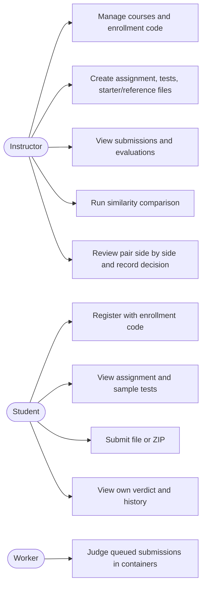
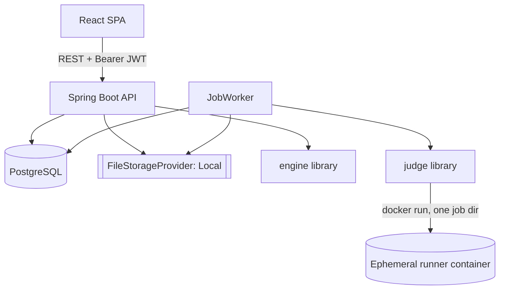
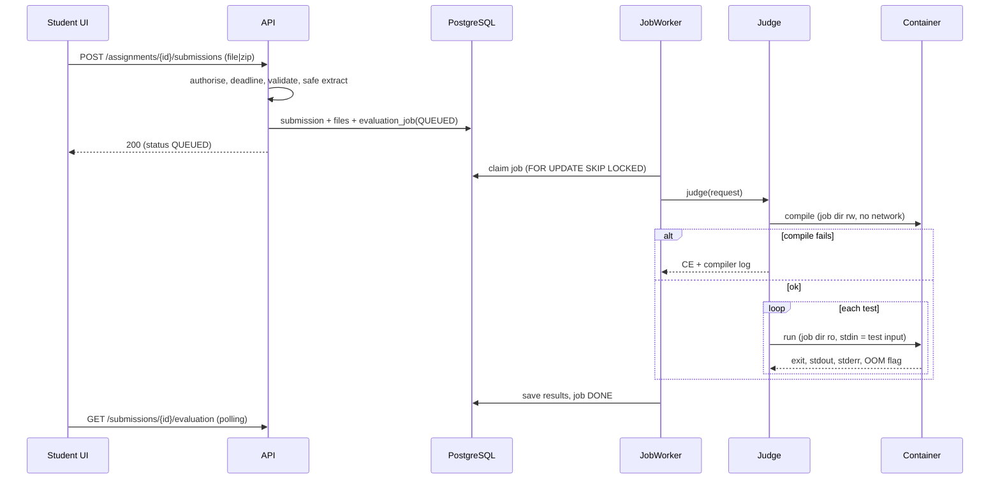
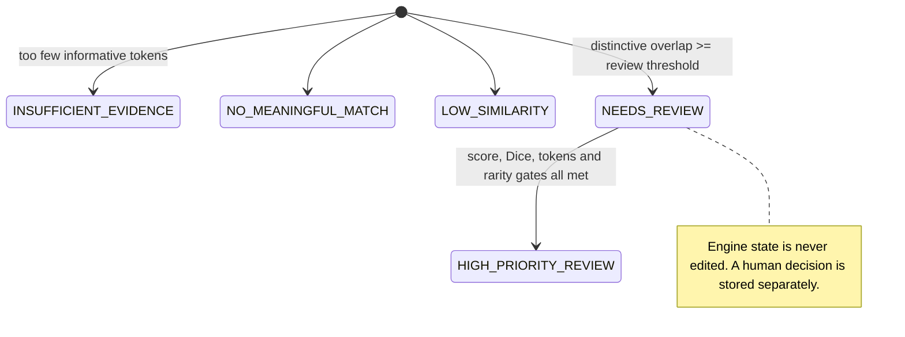
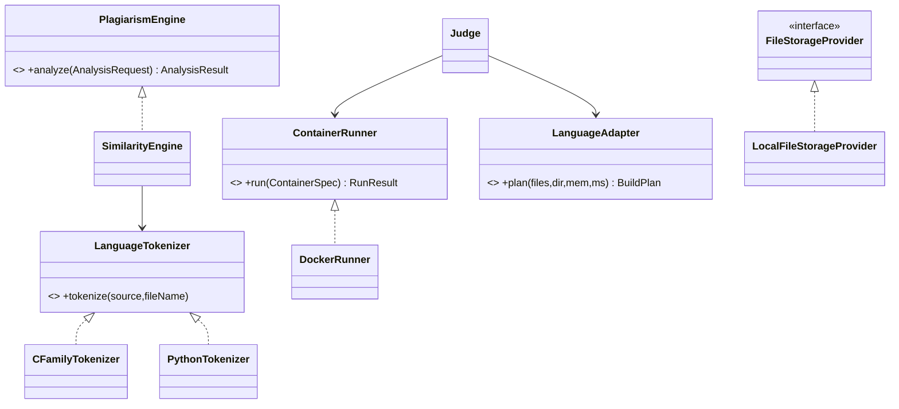
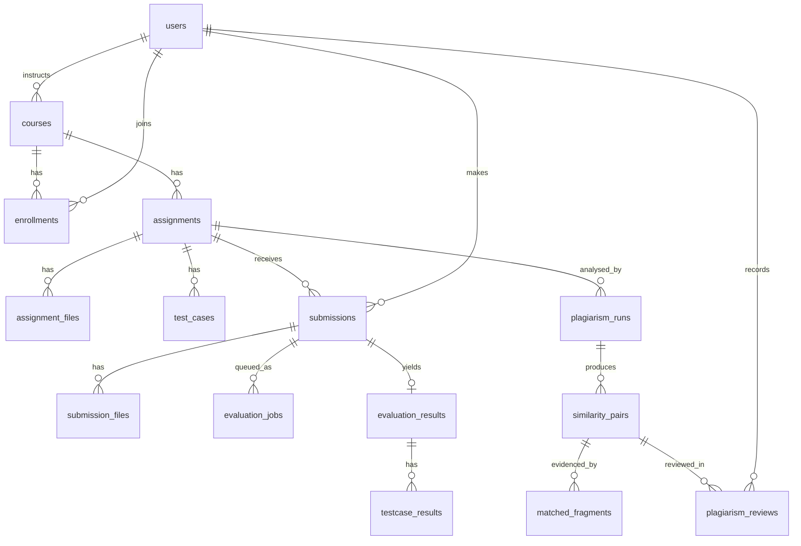

# Design diagrams (Mermaid)

## 1. Use cases

## 2. Component view

## 3. Submission and judging (sequence)

## 4. Similarity pipeline

## 5. Triage states

## 6. Key classes

## 7. Entity-relationship

