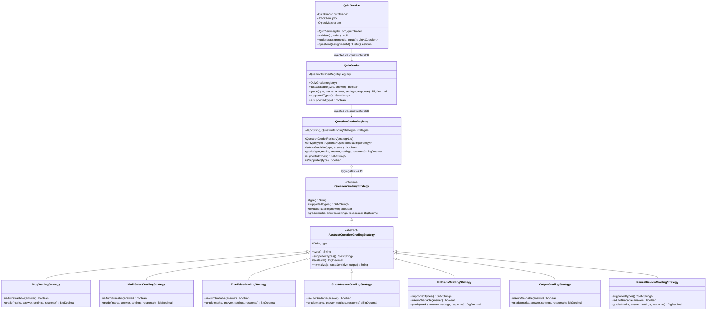
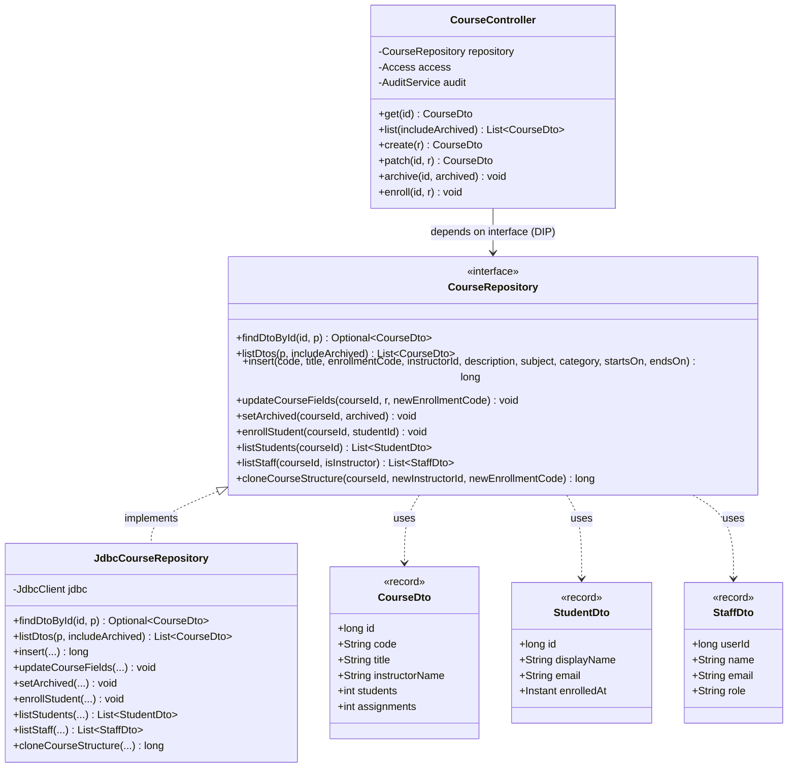
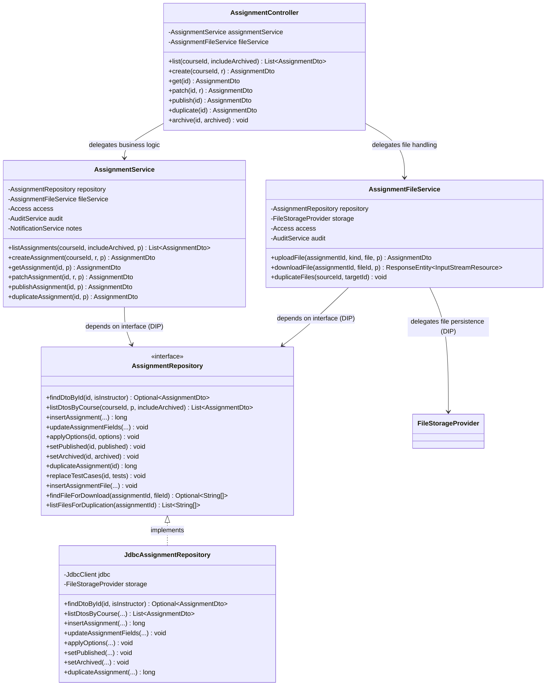
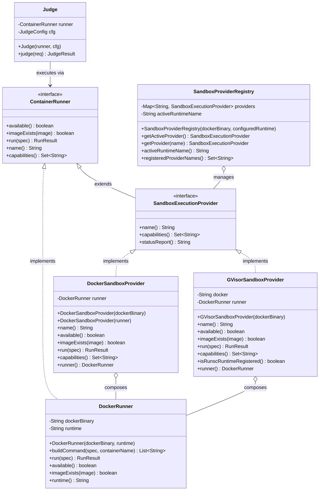
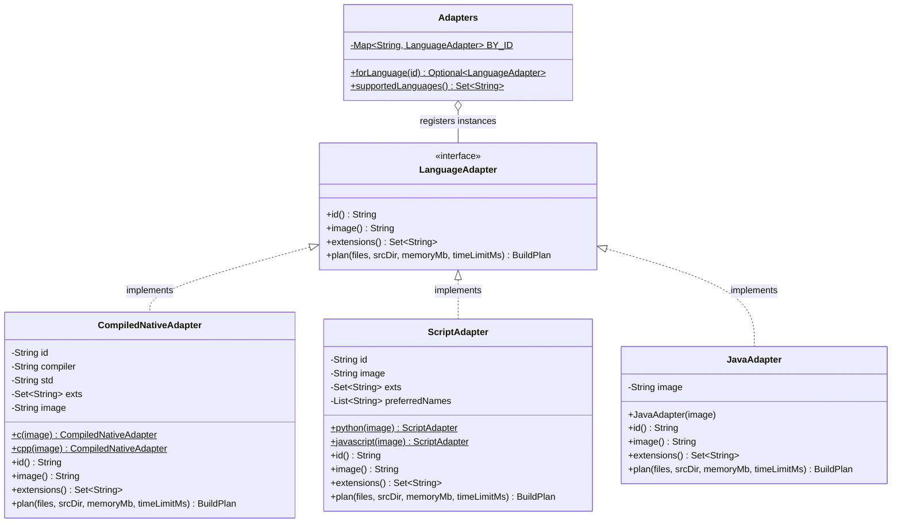
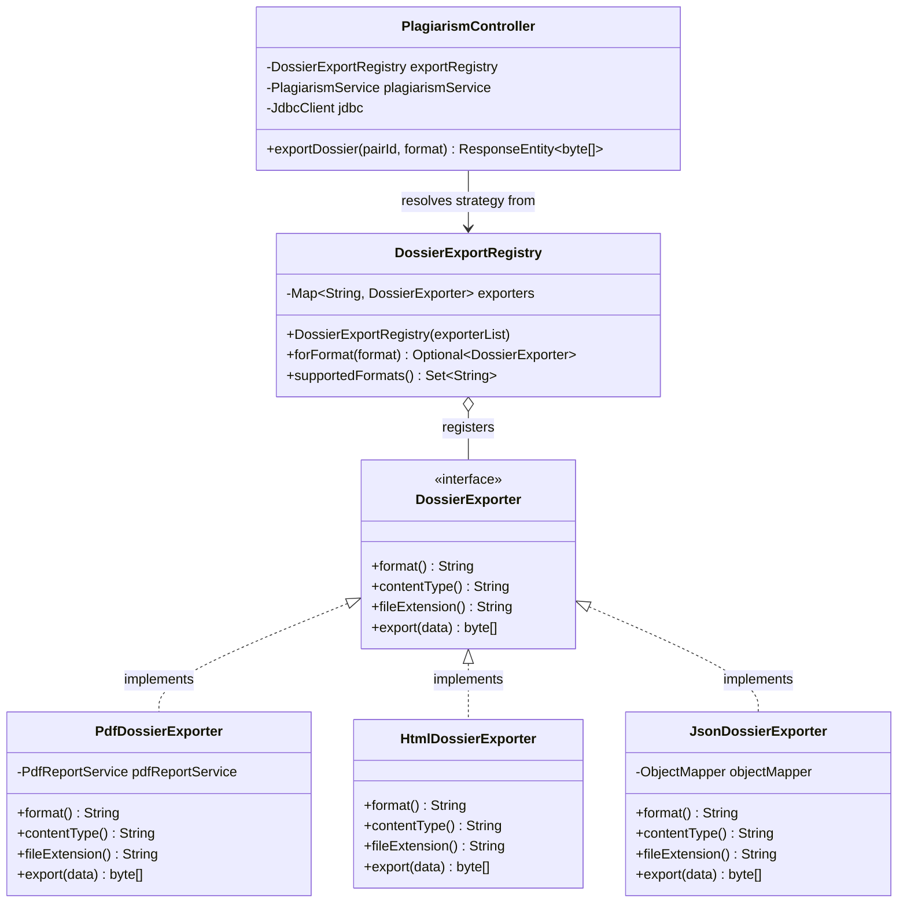

# Caliper — Object-Oriented Architecture & SOLID Design Specification

This document details the object-oriented design, architectural layering, design patterns, and SOLID principles implemented across Caliper's Java codebase (`backend`, `engine`, and `judge` modules), verified directly against the production source code.

---

## 1. The Four Pillars of OOPS in Caliper

### 1.1 Encapsulation
- **Domain Records as Data Carriers**: Caliper utilizes Java 21 `record` constructs for data transfer objects, command requests, and query projections (`AssignmentDto`, `CourseDto`, `StudentDto`, `StaffDto`, `PairSummary`, `StoredObject`). In the Java language specification, records provide shallowly immutable data carriers (components are implicitly `private final`, canonical constructors and accessors are generated by the compiler, and records cannot extend arbitrary classes or hold non-static mutable instance fields). However, records do not provide automatic deep immutability (referenced objects such as `JsonNode`, array buffers, or mutable collections remain internally mutable unless unmodifiable or defensively copied) nor complete domain encapsulation (records expose all component accessors publicly and function as transparent data carriers rather than rich encapsulated entities with hidden invariants).
- **Repository Abstractions vs. Direct SQL Access**: Dedicated repository interfaces and abstractions are implemented for core domain boundaries:
  - `CourseRepository` (implemented by `JdbcCourseRepository`)
  - `AssignmentRepository` (implemented by `JdbcAssignmentRepository`)
  - `UserRepository` (a concrete repository class executing SQL via `JdbcClient`)
  Controllers and services in these domains route data persistence through these repositories. However, complete repository encapsulation across the entire application remains an ongoing architectural goal rather than the current reality: many backend services and controllers (such as `QuizService`, `QuizController`, `PlagiarismService`, `PlagiarismController`, `SubmissionController`, `NotificationService`, `AuthService`, and reporting controllers) still inject and execute raw SQL statements directly via Spring's `JdbcClient`.
- **Controlled Object Initialization & Constructor Injection**: Spring-managed components and domain services employ constructor-based dependency injection with immutable `final` field references, guaranteeing that objects cannot be instantiated in an uninitialized or partially configured state. However, constructor injection alone does not automatically satisfy every SOLID principle: Single Responsibility requires cohesive behavior boundaries, Open/Closed requires polymorphism and extension hooks, and Dependency Inversion requires programming against abstractions rather than concrete classes.

### 1.2 Abstraction
- **Port-and-Adapter Architecture**: Critical subsystems decouple API consumers and orchestration engines from specific infrastructure details through explicit Java interfaces:
  - `AssignmentRepository` & `CourseRepository`: Abstract database persistence operations from controller routing and business services.
  - `QuestionGradingStrategy`: Abstracts question validation and evaluation algorithms from `QuizService` and `QuizGrader`.
  - `FileStorageProvider`: Abstracts physical filesystem writes and retrieval from assignment uploads, student submissions, and starter code ingestion.
  - `ContainerRunner` & `SandboxExecutionProvider`: Abstract container runtime mechanics, process execution, and security isolation from the core `Judge` grading pipeline.
  - `DossierExporter`: Abstracts document serialization (`pdf`, `html`, `json`) from the plagiarism investigation desk. (Tabular CSV exports are handled separately by dedicated controller endpoints rather than through the `DossierExporter` registry).
  - `LanguageAdapter`: Abstracts compiler and interpreter execution, file resolution, and build plan generation across C, C++, Java, Python, and JavaScript.

### 1.3 Inheritance
Inheritance is used deliberately and strictly where genuine **IS-A** polymorphism and behavioral code reuse exist:
- `AbstractQuestionGradingStrategy`: Abstract base class implementing `QuestionGradingStrategy` that provides shared text normalization (`AbstractQuestionGradingStrategy.normalize(...)`) and score decimal scaling (`scale(...)` with `RoundingMode.HALF_UP`) for concrete strategy classes (`McqGradingStrategy`, `MultiSelectGradingStrategy`, `TrueFalseGradingStrategy`, `ShortAnswerGradingStrategy`, `OutputGradingStrategy`, `FillBlankGradingStrategy`, `ManualReviewGradingStrategy`).
- `SandboxExecutionProvider`: Sub-interface extending the base `ContainerRunner` interface, augmenting the container execution contract with runtime naming, capability querying, and diagnostic status reporting.
- Exception Hierarchies: Custom runtime and checked exceptions extending Java standard library exceptions (`ApiException` extending `RuntimeException`, `SandboxException` extending `Exception`, `BuildException` extending `Exception`).
- **Language Adapters Use Composition & Parameterization, Not Inheritance**: Language execution does *not* use a subclass hierarchy. `CompiledNativeAdapter` and `ScriptAdapter` are `final` concrete classes implementing `LanguageAdapter` directly. C and C++ are instances of `CompiledNativeAdapter` configured with different compiler binaries and flags via static factory methods (`c()` and `cpp()`). Python and JavaScript are instances of `ScriptAdapter` configured via static factory methods (`python()` and `javascript()`). Java is implemented directly by `JavaAdapter`. Fictional subclasses (`CAdapter`, `CppAdapter`, `PythonAdapter`, `NodeAdapter`) do not exist.

### 1.4 Polymorphism
- **Strategy Pattern via Dependency Injection**: Concrete strategies are discovered by Spring's component scanning and injected into registry beans (`QuestionGraderRegistry`, `DossierExportRegistry`).
- **Dynamic Runtime Dispatch**: `QuizGrader` receives `QuestionGraderRegistry` through constructor injection and dispatches question evaluation dynamically based on `question.type()`, resolving the appropriate strategy at runtime without fragile `switch` or `instanceof` blocks.
- **Pluggable Execution Providers**: `Judge` dispatches container executions across `DockerSandboxProvider` or `GVisorSandboxProvider` polymorphically via the `ContainerRunner` interface.
- **Multi-Format Export Dispatch**: `PlagiarismController` delegates dossier export to `DossierExportRegistry`, resolving the appropriate `DossierExporter` implementation (`PdfDossierExporter`, `HtmlDossierExporter`, `JsonDossierExporter`) based on format parameter.

---

## 2. SOLID Principles in Practice

| Principle | Implementation in Caliper |
| :--- | :--- |
| **Single Responsibility Principle (SRP)** | • `AssignmentController` handles HTTP routing, query parsing, and response status mapping only. • `AssignmentService` enforces domain lifecycle rules, authorization checks, and publishing constraints. • `AssignmentFileService` manages multipart storage ingestion, hashing, and file duplication. • `JdbcAssignmentRepository` encapsulates SQL persistence for assignments. *(Note: Some legacy controllers such as `QuizController` and `PlagiarismController` combine HTTP routing with direct `JdbcClient` queries, representing areas for future refactoring).* |
| **Open/Closed Principle (OCP)** | • `QuestionGraderRegistry`: Adding a new question type (e.g. `PARSONS_PROBLEM`) requires only implementing a new `@Component QuestionGradingStrategy` without modifying `QuizService` or `QuizGrader`. • `DossierExportRegistry`: Adding an export format requires implementing a new `@Component DossierExporter` without modifying `PlagiarismController`. |
| **Liskov Substitution Principle (LSP)** | • Any `SandboxExecutionProvider` (`DockerSandboxProvider`, `GVisorSandboxProvider`) can substitute for `ContainerRunner` in `Judge` without altering grading orchestration or verdict generation. • Any `FileStorageProvider` (`LocalFileStorageProvider`, mock storage) can substitute transparently without breaking file ingestion contracts. |
| **Interface Segregation Principle (ISP)** | • Small, cohesive interfaces tailored to specific consumer capabilities (`DossierExporter`, `FileStorageProvider`, `ContainerRunner`, `QuestionGradingStrategy`). Consumers are never forced to depend on methods they do not invoke. |
| **Dependency Inversion Principle (DIP)** | • `AssignmentService` depends on the `AssignmentRepository` interface, not the concrete `JdbcAssignmentRepository` class. • `QuizGrader` receives `QuestionGraderRegistry` through constructor injection. • `Judge` depends on the `ContainerRunner` interface, not concrete `DockerRunner` mechanics. • `PlagiarismController` depends on `DossierExportRegistry` and `DossierExporter`, not concrete OpenPDF generator classes. |

---

## 3. Structural & Behavioral UML Diagrams

### Diagram A: Question Grading Strategy Hierarchy (Strategy Pattern)

---

### Diagram B: Course Management Architecture (SRP & Layering)

---

### Diagram C: Assignment Management Architecture (SRP & Layering)

---

### Diagram D: Pluggable Sandbox Provider Architecture

---

### Diagram E: Language Adapter Architecture (Parameterization & Composition)

---

### Diagram F: Pluggable Dossier Exporter Architecture

