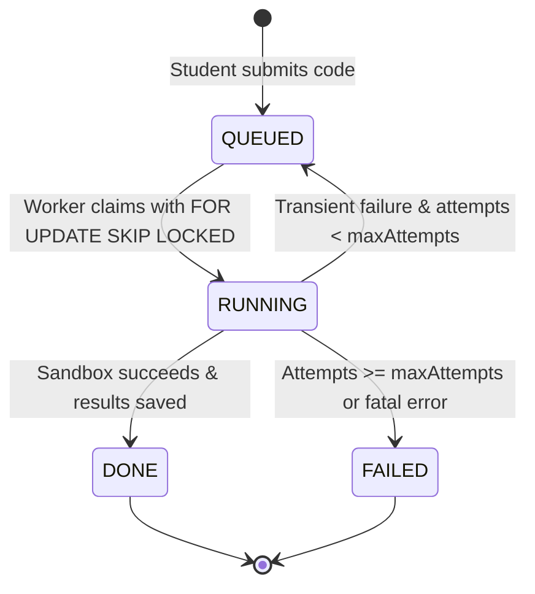

# Caliper — Background Evaluation Workers & Job Processing Architecture

This document describes the design, concurrency semantics, fault tolerance mechanisms, and operational procedures for Caliper's background evaluation pipeline.

---

## 1. Architectural Overview

Caliper implements a **resilient database-backed producer-consumer queue** over PostgreSQL. Rather than introducing heavyweight external message brokers (such as Kafka or RabbitMQ) for standard academic workloads, Caliper leverages PostgreSQL's transactional row-level locking (`FOR UPDATE SKIP LOCKED`) to achieve:
- Strict atomic job claiming.
- Safe concurrent processing across multiple worker processes.
- Zero duplicate executions.
- Zero external broker dependencies.

```
┌─────────────────────────────────────────────────────────────┐
│                       PostgreSQL                           │
│                                                             │
│   evaluation_jobs Table                                     │
│   ┌──────┬───────────────┬─────────┬───────────┬─────────┐  │
│   │  id  │ submission_id │ status  │ locked_at │ attempts│  │
│   ├──────┼───────────────┼─────────┼───────────┼─────────┤  │
│   │ 101  │      401      │ QUEUED  │   null    │    0    │  │
│   │ 102  │      402      │ RUNNING │ 10:14:02  │    1    │  │
│   │ 103  │      403      │  DONE   │ 10:12:45  │    1    │  │
│   └──────┴───────────────┴─────────┴───────────┴─────────┘  │
└──────────────────────────────┬──────────────────────────────┘
                               │
            ┌──────────────────┴──────────────────┐
            │ FOR UPDATE SKIP LOCKED              │ FOR UPDATE SKIP LOCKED
            ▼                                     ▼
 ┌──────────────────────┐              ┌──────────────────────┐
 │   Worker Process 1   │              │   Worker Process 2   │
 │                      │              │                      │
 │ 1. Claim Job Atomic  │              │ 1. Claim Job Atomic  │
 │ 2. Mount Filesystem  │              │ 2. Mount Filesystem  │
 │ 3. Execute Sandbox   │              │ 3. Execute Sandbox   │
 │ 4. Persist Results   │              │ 4. Persist Results   │
 │ 5. Cleanup Temp Tree │              │ 5. Cleanup Temp Tree │
 └──────────────────────┘              └──────────────────────┘
```

---

## 2. Job State Lifecycle & State Machine

Every evaluation job progresses through a strictly defined state machine:



### State Descriptions
1. **`QUEUED`**: The submission is recorded and waiting for an available worker thread.
2. **`RUNNING`**: An active worker has claimed the job, updated `locked_at = now()`, incremented `attempts = attempts + 1`, and marked the corresponding submission as `RUNNING`.
3. **`DONE`**: Testcases have been executed, output validated, detailed testcase records inserted, and job marked finished.
4. **`FAILED`**: The job encountered an internal error or exceeded its retry threshold (`app.worker.max-attempts`).

---

## 3. Concurrency & Collision Prevention

### Atomic Claiming
Jobs are claimed inside a database transaction using the following query:
```sql
UPDATE evaluation_jobs SET status='RUNNING', locked_at=now(), attempts=attempts+1
WHERE id = (
    SELECT id FROM evaluation_jobs 
    WHERE status='QUEUED' 
    ORDER BY id 
    FOR UPDATE SKIP LOCKED 
    LIMIT 1
)
RETURNING id, submission_id, attempts;
```
- `FOR UPDATE`: Locks the selected row against concurrent modification.
- `SKIP LOCKED`: Concurrently executing workers immediately skip locked rows without blocking, claiming the next available job in the queue.
- This guarantees that **no two workers can ever claim or execute the same job concurrently**.

---

## 4. Fault Tolerance & Crash Recovery

### 4.1 Stale Job Heartbeat Recovery (`recoverStuck`)
If a worker process is terminated abruptly (e.g. host restart, out-of-memory kill, or kernel panic) while executing a container, the claimed job remains in the `RUNNING` state.

Caliper automatically detects and recovers these orphaned jobs during each poll cycle:
```sql
-- Re-queue stale jobs that have not exceeded the attempt limit
UPDATE evaluation_jobs 
SET status='QUEUED' 
WHERE status='RUNNING' 
  AND locked_at < now() - make_interval(mins => ?) 
  AND attempts < ?;

-- Mark permanently failed if retry budget is exhausted
UPDATE evaluation_jobs 
SET status='FAILED', error='Job exceeded its attempt limit', finished_at=now() 
WHERE status='RUNNING' 
  AND locked_at < now() - make_interval(mins => ?) 
  AND attempts >= ?;
```
- Configured via `app.worker.stuck-minutes` (default: 10 minutes).
- Configured via `app.worker.max-attempts` (default: 2 attempts).

### 4.2 Idempotent Result Persistence
When test results are saved:
```java
tx.executeWithoutResult(s -> {
    jdbc.sql("DELETE FROM evaluation_results WHERE submission_id=?").param(job.submissionId()).update();
    long rid = jdbc.sql("INSERT INTO evaluation_results(...) ... RETURNING id")...;
    // Insert testcase breakdown
    jdbc.sql("UPDATE evaluation_jobs SET status='DONE', finished_at=now(), error=NULL WHERE id=?")...;
    jdbc.sql("UPDATE submissions SET status='DONE' WHERE id=?")...;
});
```
Because existing results are deleted within the same database transaction prior to inserting the new results, re-executing a retried job is strictly idempotent and cannot produce duplicate grading records.

### 4.3 Workspace Cleanup Guard
All temporary job workspaces (`/tmp/cs-job-XXXXX/`) are created on demand and recursively cleaned up in a `finally` block:
```java
finally {
    if (dir != null) deleteTree(dir);
}
```
This guarantees that disk space on the worker node is reclaimed even if the judge execution crashes or times out.

---

## 5. Configuration & Operational Commands

### Worker Properties (`application.properties` / Environment)
| Property | Environment Variable | Default | Purpose |
| :--- | :--- | :---: | :--- |
| `app.worker.enabled` | `APP_WORKER_ENABLED` | `true` | Toggles whether the host runs background workers. |
| `app.worker.poll-millis` | `APP_WORKER_POLL_MILLIS` | `1500` | Delay between queue polling passes. |
| `app.worker.stuck-minutes` | `APP_WORKER_STUCK_MINUTES` | `10` | Inactivity threshold before a running job is recovered. |
| `app.worker.max-attempts` | `APP_WORKER_MAX_ATTEMPTS` | `2` | Maximum retry attempts before marking a job failed. |

### Running a Dedicated Worker Process
In high-volume deployments, the web API and background workers can be partitioned:

```bash
# Instance 1: Web API Only (Worker Disabled)
APP_WORKER_ENABLED=false mvn spring-boot:run -pl backend

# Instance 2 & 3: Background Worker Nodes (API can be unexposed)
APP_WORKER_ENABLED=true mvn spring-boot:run -pl backend
```
Because queue management is handled via row locks in PostgreSQL, no additional clustering software or distributed coordinators are required.
